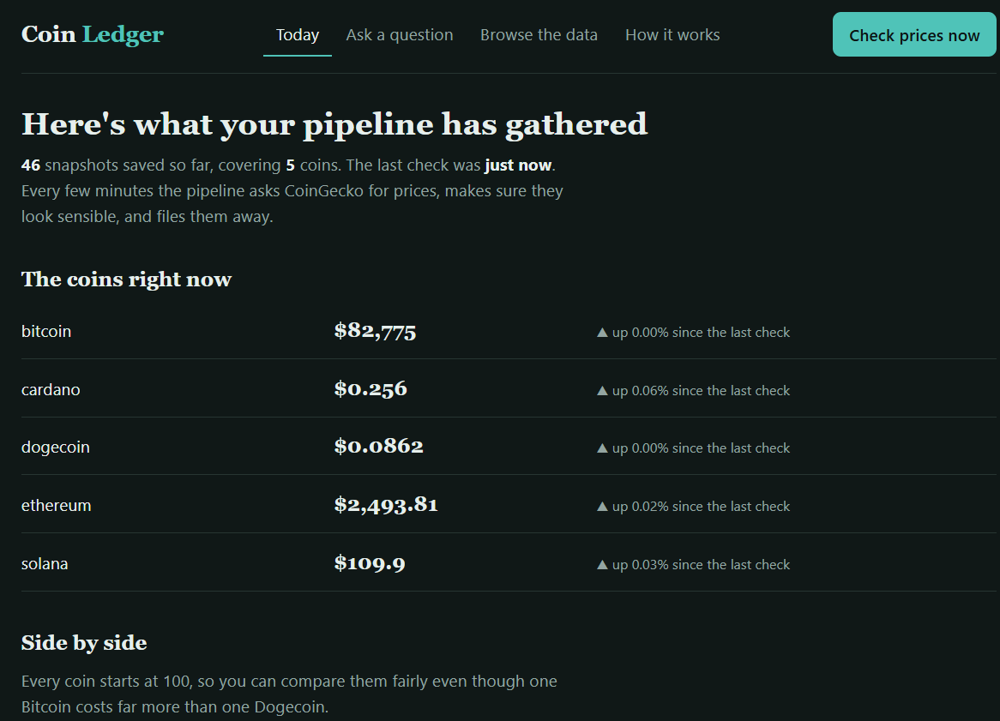
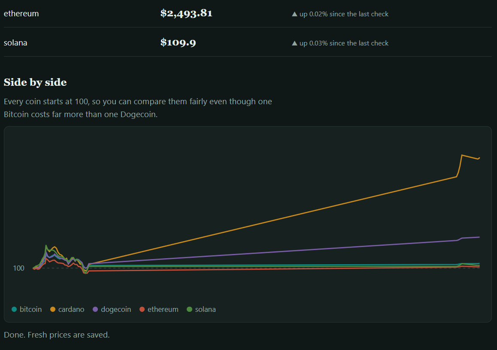

# Crypto Price Pipeline

An automated data pipeline that collects cryptocurrency prices every few minutes,
checks them, stores them in PostgreSQL, and shows them in a small web dashboard.




## What it does

CoinGecko API → quality checks → `raw_prices` → `dim_coin` + `fact_price` → dashboard

- **Extract:** Python (`requests`) pulls price, market cap and 24-hour volume for five coins
- **Validate:** a run stops if a coin is missing or a price isn't positive
- **Load:** idempotent inserts into PostgreSQL, so re-running never creates duplicates
- **Transform:** SQL builds a star schema (`dim_coin`, `fact_price`) from the raw table
- **Schedule:** a Python loop runs the whole pipeline every 5 minutes
- **Serve:** a Flask app shows live prices, a comparison chart, and a read-only SQL page

## Project layout

```
src/        extract, checks, load, transform, pipeline, scheduler, Flask app
sql/        schema.sql, model.sql, analytics.sql
docker-compose.yml
```

## Run it locally

1. Copy `.env.example` to `.env` and choose a password
2. Start the database: `docker compose up -d`
3. Create and activate a virtual environment, then `pip install -r requirements.txt`
4. Start the pipeline: `python src/scheduler.py` (leave it running)
5. In a second terminal, start the dashboard: `python src/app.py`
6. Open http://127.0.0.1:5000

## Stack

Python, SQL, PostgreSQL, Docker, SQLAlchemy, Flask